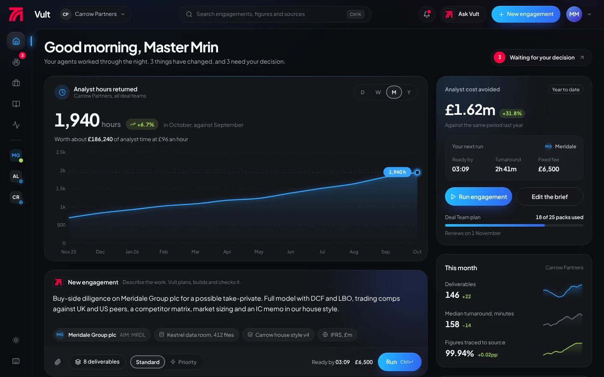
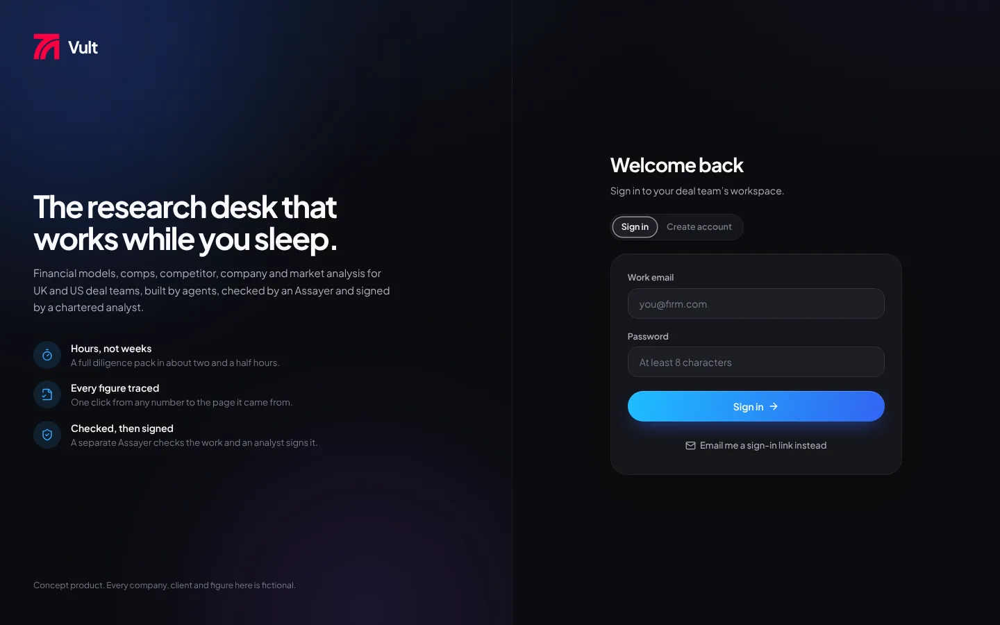
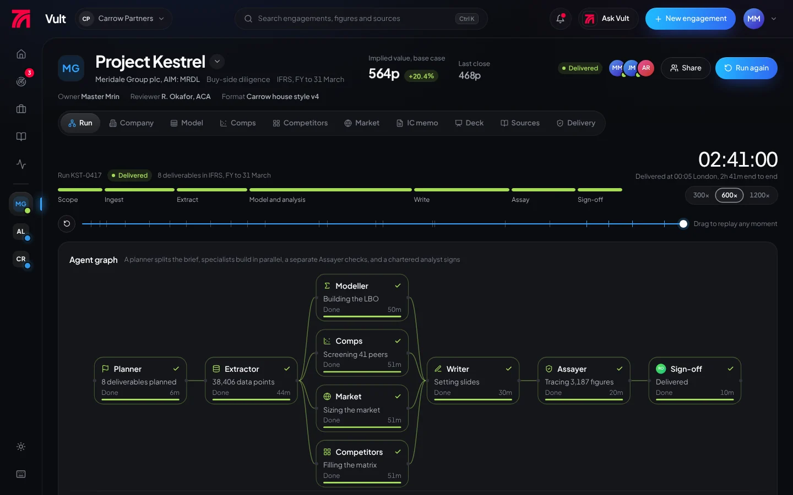
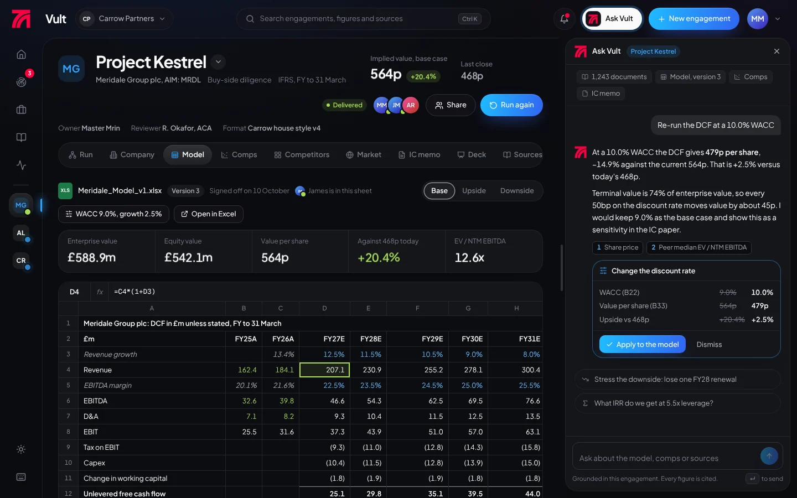

# Vult

**The AI-native research desk.** Vult turns a public filing into a linked three-statement model, DCF, comps tab, memo and tear sheet for UK and US deal teams. Numbers are read from the filing by code, a separate Assayer checks every figure against its page, and your analyst reviews what it flags. Every number clicks back to the page it came from.

This repository holds the product's web app (React) and its backend (Supabase).



> Concept product. Every company, client and figure in the demo data is fictional.

---

## Quick start

You need **Node.js 20.19 or newer** (22 LTS recommended; there is an `.nvmrc`).

```bash
npm install
npm run dev
```

Vite opens http://localhost:5173. With no Supabase keys, Vult runs entirely on its built-in demo data, so there is nothing else to set up. Open the folder in VS Code and accept the recommended extensions when prompted (ESLint, Prettier, Tailwind CSS IntelliSense, Deno).

| Command                    | What it does                                               |
| -------------------------- | ---------------------------------------------------------- |
| `npm run dev`              | Development server with hot reload                         |
| `npm run engine`           | The Vult engine: model calls and workbook recalculation    |
| `npm run start`            | Build, then serve the app and the engine on one port       |
| `npm test`                 | Unit tests for extraction, the Assayer, the model and files |
| `npm run build`            | Production build into `dist/`                              |
| `npm run preview`          | Serve the production build locally                         |
| `npm run lint`             | ESLint (React hooks and React Compiler rules included)     |
| `npm run format`           | Prettier                                                   |
| `npm run db:start`         | Start a local Supabase stack (needs Docker)                |
| `npm run db:reset`         | Rebuild the local database from migrations and seed        |
| `npm run db:seed:generate` | Regenerate `supabase/seed.sql` from the app's demo data    |
| `npm run functions:serve`  | Run the edge functions locally                             |
| `npm run functions:deploy` | Deploy the edge functions to your Supabase project         |

In VS Code, **Run and Debug → Debug Vult in Chrome** starts the dev server and attaches the debugger.

### Filing desk: 10-K to checked model

The Filing desk (`#desk`, or `G F`) is the real engine. Run the engine next to the dev server:

```bash
npm run engine     # terminal 1, http://127.0.0.1:8787
npm run dev        # terminal 2; Vite proxies /engine to the engine
```

Upload a text-based 10-K or annual report PDF. Vult:

1. reads every page in the browser (the PDF is never uploaded) and finds the income statement, balance sheet and cash flow pages;
2. asks a language model to classify the printed rows ("which row is total revenue?"). The model only returns row ids; **every number is read from the page text by code** and aligned to its year column;
3. runs the Assayer: each figure re-read from its page and column, row labels checked against the line item, required lines present, statements balance and tie, net income per share reconciled to reported EPS;
4. builds a three-statement forecast and DCF (WACC build, WACC and growth sensitivity, comps tab) as an `.xlsx` with live formulas, and recalculates it in LibreOffice to confirm the formulas agree with the engine;
5. drafts the business and risk sections from Item 1 and Item 1A (sentences containing figures are removed), and writes a `.docx` memo and a one-page tear sheet in which every figure footnotes its PDF page and printed row.

Click any figure to open the PDF page with the row and the value highlighted.

**Choosing a model.** Pick the provider in the app (Filing desk, Model) or in `.env.local` (see `.env.example`). Keys stay on the engine machine in `.vult/engine.json`, which is git-ignored.

| Provider                      | Where it runs     | Notes                                                                   |
| ----------------------------- | ----------------- | ----------------------------------------------------------------------- |
| Ollama                        | This machine      | `ollama pull qwen3:8b` (about 5 GB, fits a 6 GB GPU); larger: `qwen3:14b` |
| LM Studio                     | This machine      | Start its local server and load a model                                 |
| Groq                          | Hosted, free tier | Key from console.groq.com; default `llama-3.3-70b-versatile`          |
| Google Gemini                 | Hosted, free tier | Key from aistudio.google.com; default `gemini-2.5-flash`              |
| OpenRouter, OpenAI, Anthropic | Hosted            | Paid or free models, depending on the provider                          |
| Custom                        | Anywhere          | Any OpenAI-compatible endpoint (vLLM, a private deployment)             |

With a local model no filing text leaves the machine. With a hosted one, only statement row labels and the Item 1 and Item 1A text are sent.

**LibreOffice** (optional) lets the engine recalculate each workbook. Install it normally, or without admin rights extract the MSI into your profile with `msiexec /a LibreOffice.msi /qn TARGETDIR=%LOCALAPPDATA%\Programs\LibreOffice`. Set `VULT_SOFFICE` if it lives elsewhere. Without it the Assayer reports the recalculation check as not run.

Building with Claude Code? `CLAUDE.md` gives it the architecture, the demo/live data rules, the backend rules and the design system, so new work matches what is here.

---

## Connect Supabase

Vult switches from demo mode to live mode as soon as it finds Supabase keys. In live mode people sign in, join the demo workspaces, and every decision they make is saved: approvals, agent switches, dismissed briefings, runs and co-pilot history.

### Local (recommended for development)

Requires Docker Desktop.

```bash
npm run db:start          # starts Postgres, Auth, Storage, Realtime and Studio; applies the migration and seed
cp .env.example .env.local
```

Paste the **API URL** and the **Publishable key** (older CLIs call it the anon key) from the `db:start` output into `.env.local`, then restart `npm run dev`. Create an account on the sign-in screen; local email confirmation is off, so you are in straight away. Studio runs at http://localhost:54323.

To try the co-pilot's model-backed answers locally:

```bash
cp supabase/functions/.env.example supabase/functions/.env   # choose VULT_LLM_PROVIDER and add its key
npm run functions:serve
```

### Cloud

```bash
npx supabase login
npx supabase link --project-ref <your-project-ref>
npx supabase db push --include-seed          # schema, security rules and demo data
npx supabase secrets set VULT_LLM_PROVIDER=groq VULT_LLM_MODEL=llama-3.3-70b-versatile GROQ_API_KEY=...
npm run functions:deploy
```

Put the project URL and publishable key in `.env.local` (or your host's environment variables), and add your site's URL under **Authentication → URL Configuration** so sign-in links redirect correctly.



---

## What is in the product

| Area             | What you can do                                                                                                                             |
| ---------------- | ------------------------------------------------------------------------------------------------------------------------------------------- |
| **Filing desk**  | Upload a 10-K; get a checked three-statement model and DCF (.xlsx), memo and tear sheet (.docx); click any figure to see its PDF page |
| **Home**         | Analyst hours returned (day, week, month, year), cost avoided, the next run's price and timing, overnight findings, running engagements    |
| **Brief**        | Describe the work, pick deliverables, choose standard or priority, see the fixed fee and delivery time before you run                      |
| **Run**          | Live agent graph (Planner, Extractor, Modeller, Comps, Market, Competitors, Writer, Assayer, Sign-off), stage timeline, replay scrubber      |
| **Company**      | Tear sheet, KPIs linked to source, segment revenue, revenue bridge, ownership, management, red flags                                        |
| **Model**        | Spreadsheet view of the DCF and LBO with formulas, cell lineage, scenarios, WACC and growth sensitivities, IRR grid                         |
| **Comps**        | Sortable peer table with lease alignment, football field, growth-versus-multiple regression                                                |
| **Competitors**  | Matrix of answers with confidence and sources, positioning map                                                                              |
| **Market**       | TAM, SAM and SOM with forecast, drivers and headwinds, five forces                                                                          |
| **IC memo**      | Cited memo with hover previews of each source, tracked suggestions, comments                                                                |
| **Deck**         | Seven-slide IC deck in house style, presenter mode                                                                                          |
| **Sources**      | Every document with the pages and figures taken from it                                                                                     |
| **Delivery**     | The hallmark (maker, fineness, office, signature), integrity checks, delivered files, audit trail                                          |
| **Autopilot**    | Always-on agents, the overnight log and an approval queue: nothing is sent or changed until a person approves                              |
| **Ask Vult**     | Co-pilot that re-runs the model, stresses cases and explains valuation gaps, with every answer tied to its sources and one-click apply/undo |
| **Platform**     | Firm-wide metrics, review desks and unit economics                                                                                          |

Keyboard: `⌘K` / `Ctrl K` command palette, `⌘J` / `Ctrl J` Ask Vult, `?` all shortcuts, `G` then a letter to jump (for example `G M` for the model).




---

## How it is built

### Frontend

- **React 18** with **Vite 8** and **Tailwind CSS 4**
- **Radix UI** primitives (dialog, dropdown, popover, hover card, tooltip, switch, slider, checkbox) with Vult styling in `src/components/ui.jsx`
- **Framer Motion** and **NumberFlow** for motion, **Recharts 3** for charts, **React Flow** for the agent graph
- **cmdk** command palette, **TanStack Table** for sortable tables, **Sonner** toasts, **react-resizable-panels** for the side dock
- **Plus Jakarta Sans**, Source Serif 4 and Geist Mono, self-hosted through Fontsource
- **Supabase JS** for auth, data, realtime and edge functions

Design tokens live in `src/index.css` as HSL variables, so the dark (default) and light themes swap at runtime and any colour can take an alpha. Slides and documents always render on paper through `.light-scope`.

### Data flow

```
             ┌─────────────── demo mode (no keys) ───────────────┐
 src/lib/engine.js ──► App state ──► views          src/lib/autopilot.js
             └─────────────── live mode (keys set) ──────────────┘
 Supabase ──► src/lib/api.js ──► useLiveWorkspace ──► App state ──► views
                    ▲                                    │
                    └──── approvals, agent switches, dismissals, runs, Ask Vult
```

`src/lib/api.js` is the only file that talks to Supabase. It maps rows into exactly the shapes the demo data uses, so every view works the same in both modes. The model, comps, memo and deck calculations run in the browser from `src/lib/engine.js`; the database stores the inputs, versions and evidence behind them.

### Backend (`supabase/`)

| Piece                                   | What it holds                                                                                                                                        |
| --------------------------------------- | ---------------------------------------------------------------------------------------------------------------------------------------------------- |
| `migrations/…_vult_schema.sql`          | 19 tables: organisations, memberships, profiles, companies, engagements, runs and their events, documents, evidence, model versions, files, hallmarks, comments, co-pilot history, monitors, briefings and dismissals, approvals, activity |
| Row-level security                      | Every row belongs to an organisation. Members read; analysts and reviewers write; admins delete. Co-pilot history and dismissals are private to each person. Anonymous users see nothing. |
| `decide_approval()`                     | The only way to approve or decline an agent's request. Records who decided and, for a model update, saves a new model version.                       |
| `join_demo_workspaces()`                | Gives a new account access to the two demo workspaces.                                                                                               |
| Triggers                                | Profiles created on sign-up, `updated_at` maintained, an engagement goes back to running when a run starts.                                          |
| Storage                                 | Private `sources` and `deliverables` buckets; object paths start with the organisation id and the same membership rules apply.                       |
| Realtime                                | Approvals, briefings, engagements, runs, run events and comments are published; the app reloads its workspace when they change.                      |
| `functions/start-run`                   | Prices and plans a run on the server (the price that is billed) and records it.                                                                     |
| `functions/ask-vult`                    | Answers co-pilot questions from the engagement's traced evidence, with citations, through the provider in `VULT_LLM_PROVIDER`. Without one, the app falls back to its built-in answers. |
| `functions/extract-10k`                 | The engine’s row classification as an edge function, for live deployments without a local engine. |
| `functions/_shared/llm.js`              | One provider layer (Ollama, OpenAI-compatible, Anthropic) shared by the edge functions, the engine and the browser code. |
| `seed.sql`                              | Two fictional client firms with nine engagements each, generated from the app's demo data so both modes tell the same story.                        |

Edge functions act as the signed-in user, so row-level security applies to everything they read and write.

### Project layout

```
src/
  App.jsx               app state, routing, keyboard, run clock, co-pilot streaming
  main.jsx              fonts, styles, error boundary, auth gate
  index.css             design tokens, themes and component styles
  auth/                 sign-in screen and session handling
  components/           ui.jsx (primitives), shared.jsx (Vult atoms), charts.jsx
  hooks/                useLiveWorkspace (Supabase data and realtime)
  lib/                  engine.js (demo data and finance maths), api.js, supabase.js, formatting helpers
                        filing, pdf-text, assayer, model, workbook, memo, pipeline: the Filing desk
  views/                one file per area: home, desk, engagement tabs, library, shell (header, rail, palette)
server/
  index.js              the Vult engine: model calls, settings, LibreOffice recalculation, serves dist/
  settings.js, recalc.js
supabase/
  config.toml           local stack configuration
  migrations/           schema, security, functions, storage, realtime
  functions/            start-run, ask-vult, extract-10k and shared helpers (llm.js, statements.js)
  seed.sql              demo data
scripts/
  generate-seed.mjs     builds seed.sql from src/lib
```

---

## What is real and what is simulated

**Real:** the Filing desk. It reads a real filing, classifies rows with the model you choose, reads every figure by code, runs the Assayer, writes a formula workbook that LibreOffice recalculates, and writes the memo and tear sheet. Pass and flag counts are computed, not typed in.

**Scripted:** the demo engagements (Project Kestrel and the others) show the full product surface, and the app labels them as a scripted demo. Their run, checks and files are illustrative:

1. **The agent pipeline.** A run's progress is played back on a clock in the browser (adjustable to 300×, 600× or 1200× speed). In live mode the run itself is recorded by `start-run`; a worker that executes the stages would write `run_events` and update `runs`, and the app would follow them through realtime.
2. **The engagement content.** Model, comps, competitor matrix, market sizing, memo and deck come from `src/lib/engine.js`. The evidence trail behind them is stored in the database and is what Ask Vult answers from.

## Quality checks

- `npm run lint`, `npm test` and `npm run build` run clean; CI (`.github/workflows/ci.yml`) runs them plus Prettier and a Deno type-check of the edge functions.
- The Filing desk has been run end to end on a public 10-K with a local model (Ollama, qwen3:8b on a 6 GB laptop GPU): 87 figures read from three statement pages, 173 checks passed and 2 flagged for review, and 20 of 20 workbook cells agreeing after LibreOffice recalculation, in about two minutes.
- The schema and seed apply cleanly to PostgreSQL, and row-level security is exercised with two users (one member, one outsider).
- Live mode is tested end to end against PostgREST: sign in, read from the database, approve, toggle an agent, dismiss a briefing, start a run and ask the co-pilot.
